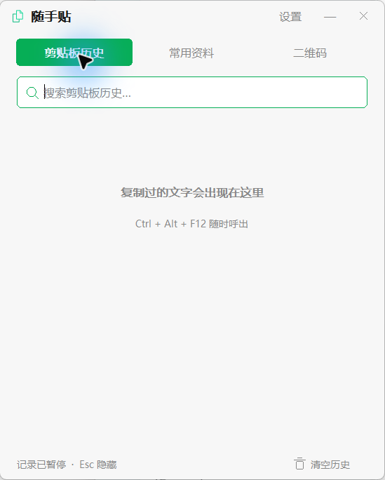
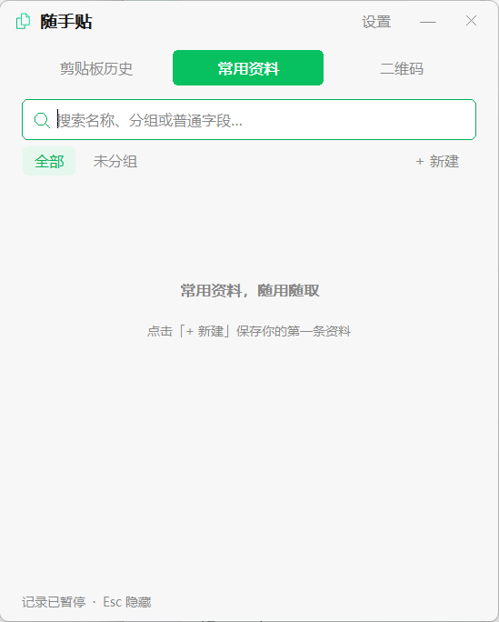

# 随手贴（QuickClipboard）

Windows 10 / 11 x64 原生剪贴板历史与常用资料工具。使用 C++20、Win32、SQLite 和 Windows DPAPI，运行时离线，无账号、遥测或网络请求。

## 程序截图

| 剪贴板历史 | 常用资料 |
|---|---|
|  |  |

截图中的数据均为虚构示例。

## 使用

运行 QuickClipboard.exe。默认 Win + V 呼出同一个窗口；每次呼出回到剪贴板历史，清空搜索并收起资料卡片。关闭和最小化只隐藏窗口，退出请使用托盘菜单。

- 剪贴板历史：记录 Unicode 文本，重复内容回到顶部，支持搜索、分页和数量/时间限制。
- 常用资料：按分组保存独立条目；查看、编辑和保存均在同一窗口完成，支持多个普通或敏感字段、置顶和字段排序。
- 二维码：切换到独立的「二维码」标签页，按 Ctrl + V 粘贴剪贴板图片，或直接拖入一张本地图片，自动离线识别。支持一图多码，相同内容合并；点击结果复制完整原文并保留窗口。识别期间可以继续输入新图片，界面只展示最新一次的结果。
- 二维码 ID：有效 URL 中有 `=` 时提取最后一个 `=` 后的内容，否则提取最后一个路径 `/` 后的内容。原始值和 ID 分行展示，各自点击复制；普通文本、只有域名或提取结果为空时仅显示原始值。提取保留原文，不限制 ID 必须为数字，不进行 URL 解码。
- 二维码生成：在二维码页底部右侧切换「识别 / 生成」。输入或粘贴文字、网址后自动生成，支持中文和多行内容；点击二维码图片选择位置保存为 PNG。默认文件名按上述 ID 规则提取，无 ID 时使用点击保存时的本地时间 `yyyyMMddHHmmss`，文件名中的无效字符会替换为下划线。切换模式保留各自内容。
- 资料排序：按住资料卡片标题约 400 毫秒，显示拖拽柄、浮动标题和四向移动指针后上下拖动，松手自动保存；靠近列表边缘自动滚动和加载更多。顺序在分组与搜索结果中共用，置顶资料与普通资料分别排序；按 Esc、失焦或拖到列表外松手取消。排序不修改字段值，新建资料追加到已排序资料之后。
- 操作：↑↓ 选择、Enter 操作、Esc 收起或隐藏、Ctrl + 左右切换标签、Ctrl + S 保存当前表单。
- 分组：随窗口宽度平铺，放不下的进入「更多」，未分组位于末尾。
- 字段：点击值只复制并保留窗口；右侧粘贴按钮切回原应用粘贴。长内容预览两行，可展开全文，操作始终使用完整值。
- 搜索和表单：圆角输入区、细线焦点、清除搜索、微信绿色主题；下拉框禁止滚轮误选，仍可点击或使用方向键。
- 清空历史：位于历史页底栏右侧，确认后清空；常用资料保持独立。

默认快捷键接管系统 Win + V，退出后恢复系统行为。可在设置中改用包含 Ctrl 或 Alt 的组合键。正常失焦保持可见；窗外点击隐藏可单独启用，二维码页始终保持可见以便拖入图片。

## 数据和隐私

默认数据文件是程序旁的 data/database.db，路径不受启动工作目录影响。程序目录需要可写；SQLite 运行时还会使用 database.db-wal 和 database.db-shm。可用 --data-dir 指定其他目录。

程序只读取指定目录的 database.db，不扫描其他用户目录，不转换数据库文件名，不导入其他程序数据，也不改写不受支持的数据库结构。

二维码原图、识别结果和生成输入只在内存中处理，不写入数据库；生成图片仅在主动保存时写入所选位置。支持 Windows 图片解码器可读取的 PNG、JPEG、BMP 等格式；一次读取一张图片，最大 128 MB、约 2500 万像素，过大的图片可截取二维码区域后识别。

普通历史、字段、名称和备注为明文；敏感字段使用当前 Windows 用户的 DPAPI 加密，不参与搜索。名称、备注和字段名应避免填写秘密。敏感值复制时设置系统历史和同步排除格式，默认 30 秒后仅清理仍由本次操作写入的内容。

从历史转存为敏感字段会移除源历史。其他剪贴板工具、数据库 WAL、系统快照和备份仍可能保留副本；应用不承诺物理擦除。DPAPI 不能隔离同一用户下的恶意软件，专业凭据应交由密码管理器保存。

备份前从托盘正常退出，再复制整个 data 目录。跨 Windows 用户或机器复制数据，不保证能解密敏感字段。程序不自动备份或上传数据。

## 自启动

「登录 Windows 后静默启动」勾选时立即添加当前用户 Run 的 QuickClipboard 项，取消时立即删除，无需再点保存。系统注册失败会显示错误；数据库写入失败会恢复原启动项。

登录启动使用 --hidden，仅驻留托盘和监听剪贴板。重复静默启动不会唤出窗口；启动时只读取当前系统配置，不自动重建或修正启动项。更换程序位置后可重新勾选以更新路径。

## 构建和验证

需要 Windows x64、CMake 3.24+、Visual Studio 2022 Build Tools 的 C++ 桌面开发工作负载与 Windows SDK。SQLite、ZXing-C++ 3.1.1 和图标源文件随仓库提供，构建不下载依赖。

~~~powershell
.\scripts\build.ps1
~~~

脚本更新图标、执行 Release 构建与自动测试，生成 dist/QuickClipboard.exe 和版本压缩包。也可手动运行：

~~~powershell
cmake -S . -B build -A x64
cmake --build build --config Release --parallel
ctest --test-dir build -C Release --output-on-failure
~~~

开发时使用隔离数据目录：

~~~powershell
.\build\Release\QuickClipboard.exe --data-dir "$PWD\test-results\manual-data"
~~~

程序只依赖 Windows 系统 DLL，SQLite、ZXing-C++ 和 CRT 静态链接，不支持 Linux 原生运行。ZXing-C++ 仅编译二维码读写，使用自带编码器，无需额外生成库；生成采用 M 级纠错、四模块白边和整数倍缩放。第三方许可见 THIRD_PARTY_NOTICES.txt。ICO 包含 16～256 像素的 9 个尺寸，透明背景的双文档轮廓同时用于程序、窗口和托盘。图标矢量源文件为 assets/quickclipboard.svg，可运行 scripts/build-icon.ps1 单独更新。

当前版本为 1.1.0。自动测试覆盖数据库、安全、启动项、图标资源和界面逻辑。真实 Win + V 键盘操作、Windows 10、多显示器混合 DPI、长时间运行及异常磁盘场景仍需专项验证。
